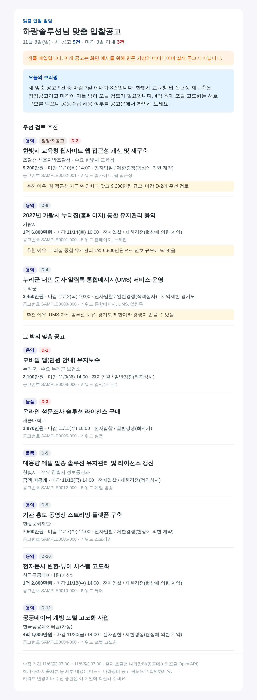

# 나라장터 맞춤 입찰공고 알림

평일 아침 7시, 고객마다 조건(키워드·금액·지역·기관)에 맞는 나라장터 입찰공고만 골라 메일로 보내는 서비스입니다.
한 번 설정해 두면 GitHub Actions가 매일 알아서 돌리므로, 운영자가 자는 동안에도 메일이 나갑니다.



> 위 화면은 가상 공고로 만든 샘플입니다(`sales/sample-digest.html`).

## 무엇을 해 주나

- **매일 자동 수집:** 조달청 나라장터 Open API에서 용역·물품·공사·외자 공고를 받습니다.
- **고객별 맞춤 필터:** 키워드 포함·제외, 추정가격 범위, 참가제한지역, 기관명으로 거릅니다.
  - 공백을 무시해서 "홈페이지 구축"은 "홈페이지구축"에도 걸립니다.
  - `+`로 묶으면 두 단어가 모두 있어야 합니다(`앱+유지보수`).
- **마감 임박 표시:** 마감이 3일 이내면 빨간 D-day 배지를 붙이고, 정정·재공고도 따로 표시합니다.
- **AI 브리핑(선택):** 고객 회사 소개를 기준으로 Claude가 우선 검토할 공고 3건과 이유, 짧은 총평을 씁니다.
- **엑셀 첨부:** 모든 맞춤 공고를 CSV로 첨부합니다. 엑셀에서 바로 열 수 있고 한글이 깨지지 않습니다.
- **빠짐·중복 방지:** 매일 07:00 기준으로 기간을 고정합니다. 실행이 늦어져도 공고가 빠지거나 두 번 가지 않고, 월요일에는 주말분까지 함께 보냅니다.

## 1. 바로 미리보기 (키 없이 1분)

Python 3.11 이상이 필요하고 따로 설치할 패키지는 없습니다.

```bash
cd bid-alert
python -m bidalert preview --out out
# out/하랑솔루션.html 을 브라우저로 열어 보세요
```

## 2. 준비물

| 항목 | 어디서 | 비용 |
|---|---|---|
| 나라장터 API 키 | [공공데이터포털](https://www.data.go.kr) → "조달청_나라장터 입찰공고정보서비스" 활용신청 → 마이페이지에서 **Decoding 키** 복사 | 무료 |
| 발송용 메일 계정 | Gmail(2단계 인증 후 **앱 비밀번호** 발급) 또는 네이버 메일(환경설정에서 SMTP 사용) | 무료 |
| (선택) Anthropic API 키 | [console.anthropic.com](https://console.anthropic.com) | 사용량 과금 |

- **API 키:** 활용신청 승인 전에는 인증 오류(코드 30)가 납니다. Encoding 키를 넣어도 코드가 알아서 풀어 쓰지만, Decoding 키를 권장합니다.
- **AI 비용(추정):** 기본값은 `claude-opus-5-5` 모델에 낮은 사고 수준(effort low)입니다. 공고가 많은 날 기준으로 고객 1곳당 하루 100원 안팎으로 예상하는데, 실제 사용량으로 측정한 값은 아닙니다. 모델은 `BIDALERT_AI_MODEL`로, 사고 수준은 `BIDALERT_AI_EFFORT`로 바꿀 수 있습니다.

## 3. 내 컴퓨터에서 실행

```bash
cd bid-alert
cp subscribers.example.toml subscribers.toml   # 고객 정보로 고치기 (저장소에는 안 올라감)

export DATA_GO_KR_SERVICE_KEY="발급받은_Decoding_키"
python -m bidalert check                       # 설정·API 키 점검
python -m bidalert run --dry-run               # 보내지 않고 out/ 에 메일 파일 생성

export SMTP_HOST=smtp.gmail.com SMTP_USER=내주소@gmail.com SMTP_PASSWORD="앱비밀번호16자리"
python -m bidalert run                         # 실제 발송
```

자주 쓰는 옵션:

| 옵션 | 뜻 |
|---|---|
| `--only 하랑솔루션` | 그 고객 한 명만 처리 |
| `--start 202611060700 --end 202611090700` | 지정한 기간으로 다시 보내기(KST) |
| `--no-ai` | AI 브리핑 끄기 |
| `--skip-empty` | 맞는 공고가 없는 날은 보내지 않기 |
| `--include-closed` | 이미 마감된 공고도 포함(잠재 고객용 "지난 2주 리포트"에 사용) |

## 4. 자동 발송 켜기 (GitHub Actions)

`.github/workflows/bid-alert.yml`이 평일 07:07(KST)에 돌아갑니다.

1. **저장소를 비공개(Private)로 바꿉니다.** 공개 저장소라도 고객 정보는 시크릿에만 있지만, 실행 로그와 코드가 모두에게 보입니다.
2. Settings → Secrets and variables → Actions → **Secrets**에 아래 값을 넣습니다.

| 이름 | 필수 | 값 |
|---|---|---|
| `DATA_GO_KR_SERVICE_KEY` | 예 | 공공데이터포털 Decoding 키 |
| `SUBSCRIBERS_TOML` | 예 | `subscribers.toml` 파일 내용 전체 |
| `SMTP_HOST` | 예 | 예: `smtp.gmail.com`, `smtp.naver.com` |
| `SMTP_USER` | 예 | 발송 계정 주소 |
| `SMTP_PASSWORD` | 예 | 앱 비밀번호 |
| `SMTP_PORT` / `SMTP_SECURITY` | 아니오 | 기본은 587 / `starttls`. 네이버는 `465` / `ssl` |
| `MAIL_FROM` / `MAIL_REPLY_TO` | 아니오 | 보내는 주소 / 회신 받을 주소 |
| `ANTHROPIC_API_KEY` | 아니오 | 넣으면 AI 브리핑이 켜집니다 |

3. **Variables**(공개돼도 되는 값)에는 `BIDALERT_BRAND`(서비스 이름, 예: "입찰알리미")와 `BIDALERT_CONTACT`(메일 하단 연락처)를 넣습니다.
4. Actions 탭에서 "입찰공고 아침 알림"을 연 뒤 **Run workflow**를 누르고, `dry_run`에 체크해 한 번 시험합니다. 로그에 고객별 건수가 나오면 성공입니다.
5. 다음 날 아침부터는 자동으로 나갑니다.

**실패했을 때:**
- 나라장터 오류로 일부 공고를 못 받거나 발송에 실패하면 실행이 빨간색(실패)으로 표시되고, GitHub이 운영자에게 알림 메일을 보냅니다.
- 로그에 다시 보낼 기간이 찍히니, Run workflow에서 `start`와 `end`를 그 값으로 넣어 다시 실행하면 됩니다.

**고객 추가·변경:** `SUBSCRIBERS_TOML` 시크릿만 고치면 다음 날부터 반영됩니다. 잠시 멈출 고객은 `active = false`로 둡니다.

## 5. 운영할 때 알아 둘 것

- **발송 한도:** 개인 Gmail·네이버 계정은 하루 발송 수에 제한이 있습니다. 고객이 수십 곳을 넘으면 메일 전용 발송 서비스(SMTP 제공)로 옮기세요.
- **링크:** 공고 상세 링크는 API가 주는 `bidNtceDtlUrl`을 씁니다. 값이 비어 있는 공고는 공고번호만 보여 줍니다.
- **광고 메일 규정:** 요금을 낸 고객에게 보내는 알림은 서비스 제공이지만, 잠재 고객에게 보내는 홍보 메일은 정보통신망법상 사전 동의와 "(광고)" 표시가 필요합니다.
- **책임 범위:** 메일 하단에 "세부 내용은 나라장터 원문으로 확인" 문구가 들어갑니다. 참가자격 판단은 고객 몫이라는 점을 이용약관에도 적어 두세요.

## 6. 개발

```bash
python -m unittest discover -s tests -t .     # 외부 연결 없이 도는 단위 테스트
```

| 파일 | 역할 |
|---|---|
| `bidalert/nara.py` | 나라장터 API 호출·페이지 넘김·재시도·오류 해석 |
| `bidalert/matcher.py` | 고객 조건 매칭과 정렬 |
| `bidalert/ai.py` | Claude 브리핑(선택) |
| `bidalert/digest.py` | 메일 HTML·텍스트·CSV 생성 |
| `bidalert/mailer.py` | SMTP 발송 |
| `bidalert/window.py` | 수집 기간 계산 |
| `bidalert/cli.py` | 명령줄 진입점 |

**API 규격:** 조달청_나라장터 입찰공고정보서비스(공공데이터포털 데이터번호 15129394)의 `getBidPblancListInfo*PPSSrch` 오퍼레이션을 씁니다. 이 작업 환경에서는 공공데이터포털에 접속할 수 없어 실제 응답으로는 검증하지 못했습니다. 대신 같은 API를 쓰는 공개 패키지 `@opendata-kr/narajangteo-bid-mcp` 0.6.0의 소스로 주소, 파라미터, 응답 필드를 대조했습니다. 키를 받으면 먼저 `python -m bidalert check`로 확인하세요.
