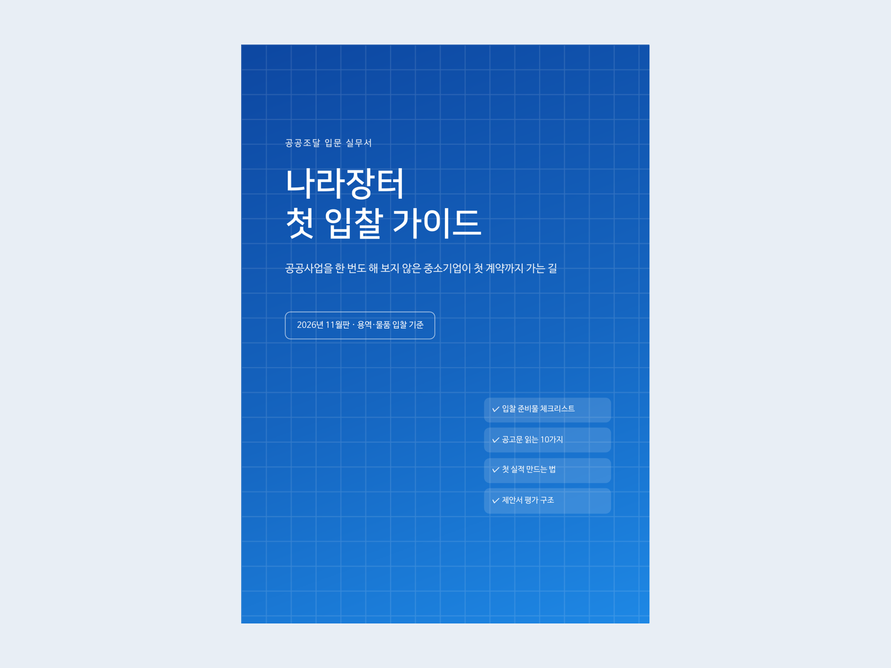

# 전자책: 나라장터 첫 입찰 가이드

공공사업 경험이 없는 중소기업을 위한 24쪽(A5) 입문 실무서입니다. PDF는 바로 판매하거나 무료로 배포할 수 있습니다.



| 파일 | 내용 |
|---|---|
| `나라장터-첫-입찰-가이드.pdf` | 완성본. 지은이 칸은 비어 있고, 9장 신청처는 기본 문구 |
| `first-bid-guide.md` | 원고. 고칠 때는 이 파일만 고치면 됩니다 |
| `cover.png`, `thumbnail-4x3.png` | 표지와 판매 페이지용 썸네일 |
| `FACT-CHECK.md` | **판매 전에 읽기:** 사실 확인 근거와 직접 확인할 항목 |
| `build.py`, `render.mjs` | PDF 생성 스크립트 |

## 목차

1. 공공조달, 왜 중소기업에 기회인가
2. 먼저 잡아야 할 용어
3. 입찰 전 준비물 체크리스트
4. 공고 찾기와 공고문 읽는 법 (확인 항목 10가지)
5. 첫 실적 만들기: 소액 수의계약
6. 가격으로 겨루는 입찰: 적격심사 기초
7. 제안서로 이기는 입찰: 협상에 의한 계약
8. 첫 입찰에서 자주 하는 실수 10가지
9. 매일 공고를 놓치지 않는 습관 (알림 서비스 안내)

부록에는 준비물 한 장 체크리스트, D-day 체크리스트, 공고 검토 메모 양식, 도움받을 곳을 실었습니다.

## 내 이름과 신청 주소를 넣어 다시 만들기

```bash
pip install markdown
npm install playwright && npx playwright install chromium   # 처음 한 번
# 한글 글꼴: 나눔 글꼴 권장 (Ubuntu: sudo apt install fonts-nanum)
python build.py --author "하랑솔루션" --cta "kmong.com/gig/OOOO 또는 help@example.com"
# → dist/나라장터-첫-입찰-가이드.pdf
```

## 어떻게 쓸까

이 책은 **알림 서비스 고객을 데려오는 미끼**로 쓰는 것을 권합니다. 9장 끝에 알림 서비스 무료 체험 안내가 들어 있습니다.

- **무료 배포:**
  - 블로그나 카페에 "나라장터 첫 입찰 체크리스트 무료 PDF"로 올립니다.
  - 받는 사람의 이메일을 받고(마케팅 수신 동의 포함) 알림 체험을 권합니다.
- **저가 판매:**
  - 크몽 같은 전자책 마켓에 낮은 가격으로 올려 검색 노출을 얻습니다.
  - 구매자에게 알림 서비스를 안내합니다.
  - 판매 문구는 `../bid-alert/sales/listing-copy.md`에 있습니다.
